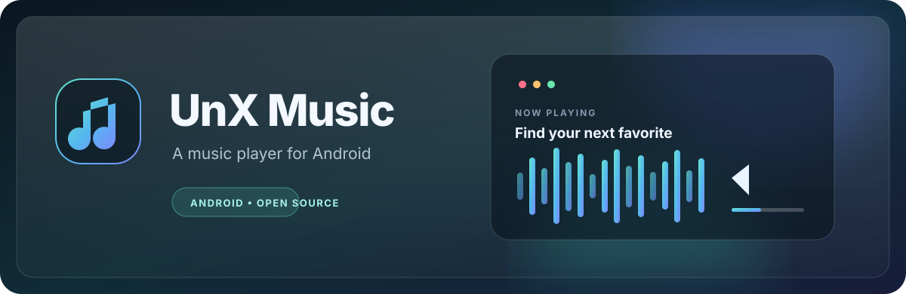
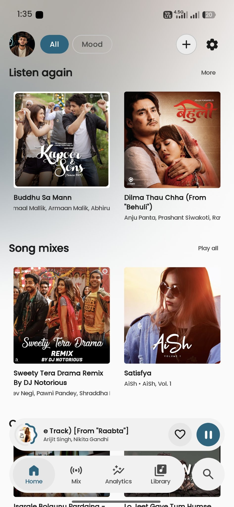
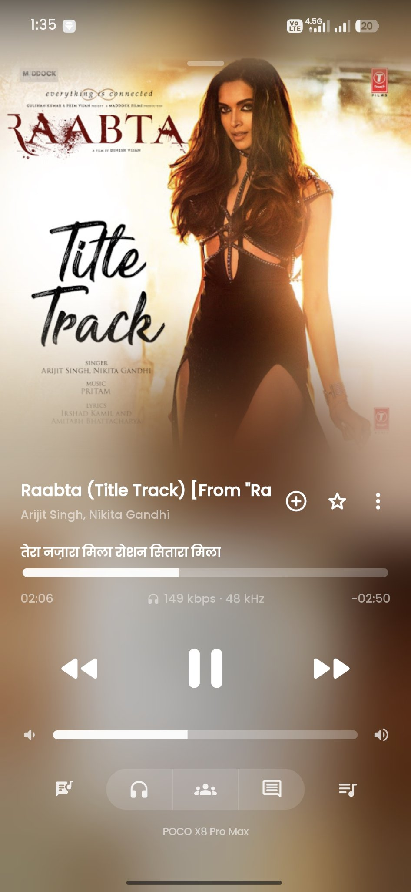
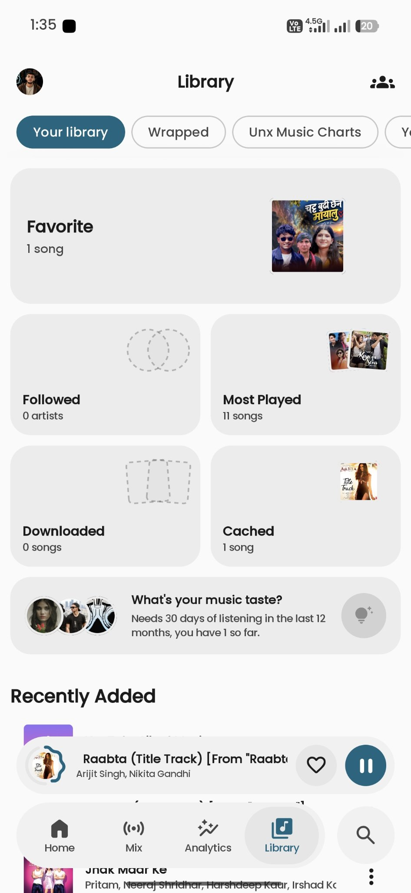
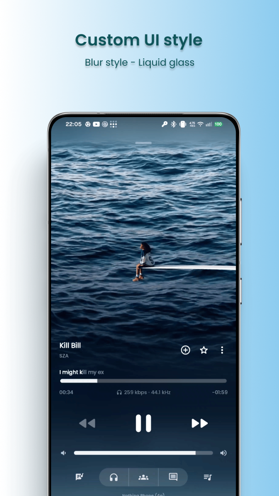
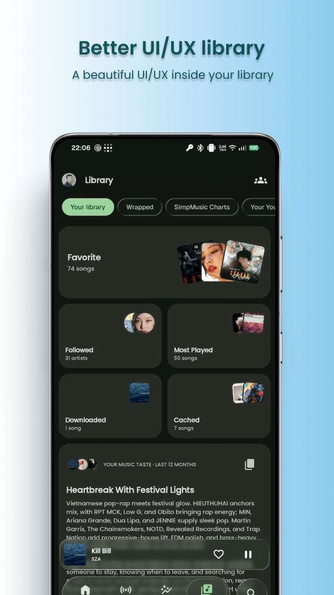
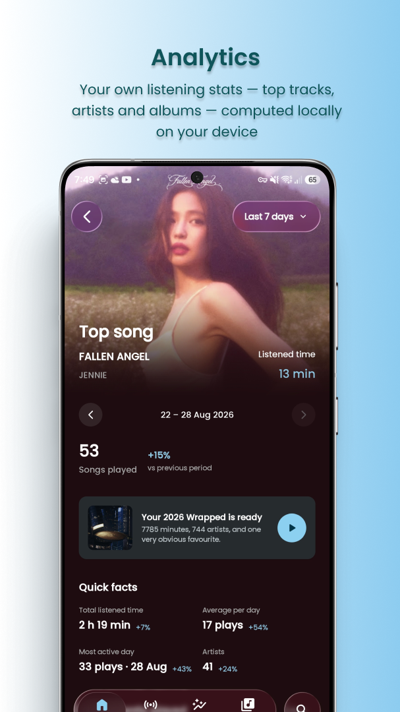

  
  <h1>UnX Music</h1>
  
<strong>UnX Music is an open-source Android music player built with Kotlin and Jetpack Compose.</strong>

  
  
  
  

---

**UnX Music** is an open-source Android music player application. This repository publishes its Kotlin/Jetpack Compose source code, Android APK releases, app screenshots, build instructions, and support information. UnX Music is based on [SimpMusic](https://github.com/maxrave-dev/SimpMusic) and is an independent community distribution, not the upstream SimpMusic project.

| Project | Details |
| --- | --- |
| App | UnX Music |
| Current release | [Latest GitHub release](https://github.com/thalalbinod208-cell/UnxMusic/releases/latest) · **2.6.29** |
| Android application ID | `com.unx.muice` |
| Android label | `UnX Music` |
| Current version code | `92` |
| Main stack | Kotlin · Android · Jetpack Compose · Media3 |
| Source license | [GPL-3.0-or-later](LICENSE) |

Online music data and playback rely on third-party services and may change independently of this app. See [Support](SUPPORT.md) for known limits and troubleshooting.

## Screenshots

<table>
  <tr>
    <td align="center" width="33%"> <strong>Home</strong></td>
    <td align="center" width="33%"> <strong>Now Playing</strong></td>
    <td align="center" width="33%"> <strong>Library</strong></td>
  </tr>
</table>

Browse the [complete visual asset library](docs/ASSET_LIBRARY.md), including app icon explorations, feature boards, controls, and the supplied feature and UI reference boards.

## Feature visuals

<table>
  <tr>
    <td align="center" width="33%"> <strong>Player visual</strong></td>
    <td align="center" width="33%"> <strong>Library visual</strong></td>
    <td align="center" width="33%"> <strong>Analytics visual</strong></td>
  </tr>
</table>

These feature boards are visual references; the [asset library](docs/ASSET_LIBRARY.md) distinguishes supplied concept artwork from the current app screenshots above.

## Get the app

### [Download the latest APK](https://github.com/thalalbinod208-cell/UnxMusic/releases/latest)

Current source version: **2.6.29** · Application ID: `com.unx.muice`

## Build from source

See [BUILDING.md](BUILDING.md) for the Android build command, output location, and release-signing requirements. APK builds and signing are performed locally; this repository does not build APKs through GitHub Actions. Never commit signing keys or local service credentials.

## Contribute and get support

- Read [contribution guidelines](CONTRIBUTING.md) before opening a pull request.
- For app help or a bug report, use [GitHub Issues](https://github.com/thalalbinod208-cell/UnxMusic/issues/new/choose) or read [Support](SUPPORT.md).
- Report security concerns using the steps in [SECURITY.md](SECURITY.md).
- For project updates, see [GitHub Releases](https://github.com/thalalbinod208-cell/UnxMusic/releases).

## Credits and licenses

This is a modified distribution based on SimpMusic. Keep upstream attribution and the original GPL terms when redistributing. Historical upstream changelog entries and internal service names may still say “SimpMusic”; they identify upstream work/services and are intentionally not rewritten as UnX Music history.

- [GPL-3.0-or-later license](LICENSE)
- [Original upstream README](UPSTREAM_README.md)
- [Third-party notices](THIRD_PARTY_NOTICES.md)
- [Third-party license texts](LICENSES/)
- [Visual asset notes and attribution](docs/ATTRIBUTION.md)

## Links

- [Source code](https://github.com/thalalbinod208-cell/UnxMusic)
- [All releases](https://github.com/thalalbinod208-cell/UnxMusic/releases)
- [Report an issue](https://github.com/thalalbinod208-cell/UnxMusic/issues/new/choose)
